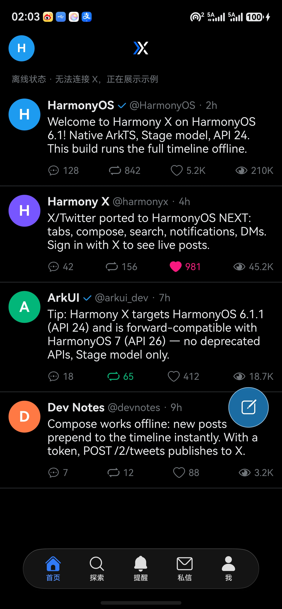
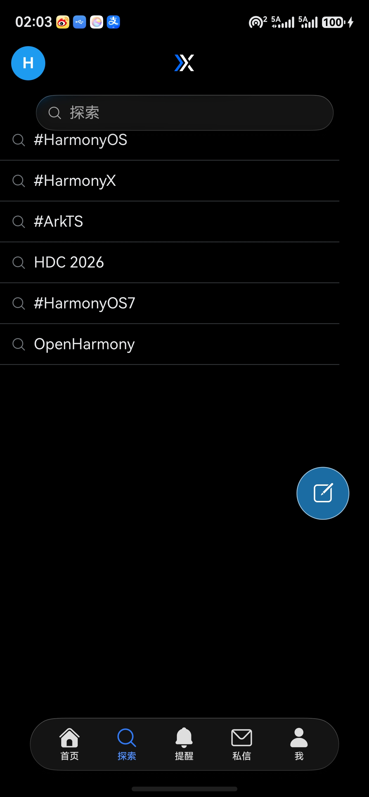
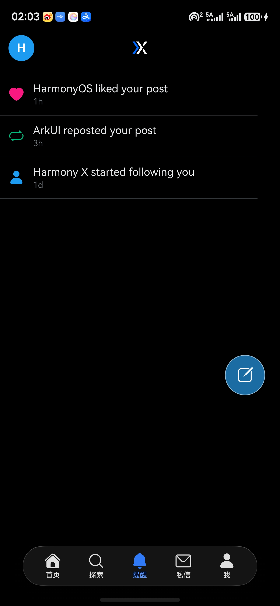
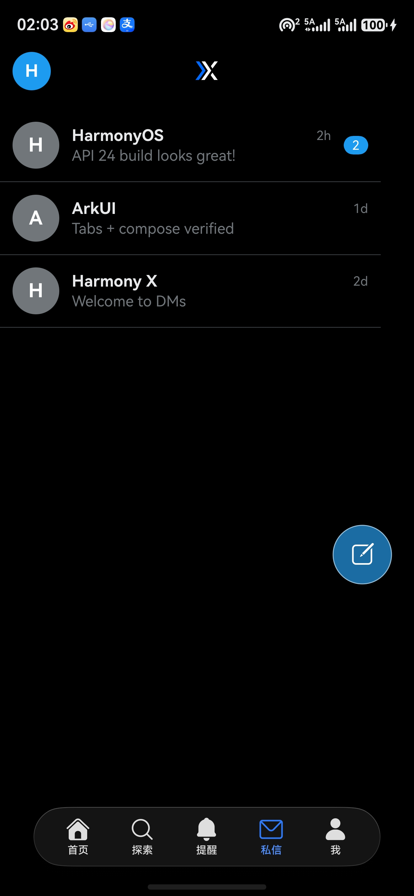
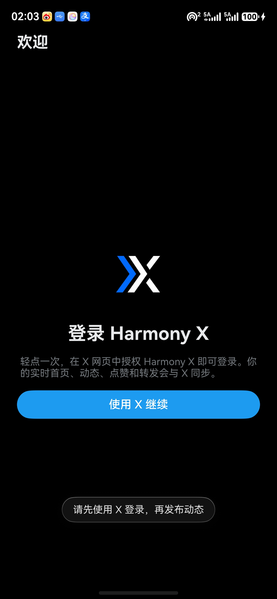
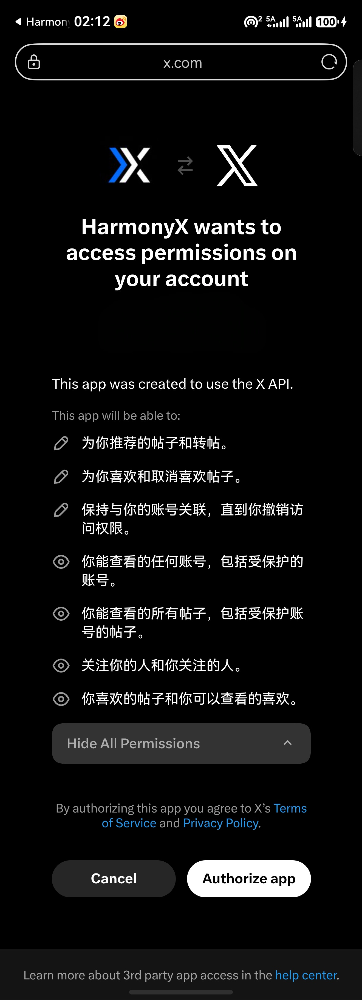

<p align="center">
  
</p>

<h1 align="center">Harmony X</h1>

<p align="center">
  面向 HarmonyOS 的原生 X 客户端。<br>
  基于 ArkTS 与 Stage 模型，专注于沉浸、简洁且贴合设备的深色体验。
</p>

<p align="center"><a href="README.en.md">English</a></p>

<p align="center">
  
  
  
</p>

<p align="center">
  <a href="#功能概览">功能概览</a> ·
  <a href="#界面预览">界面预览</a> ·
  <a href="#相对-opentwit-的改造">相对 OpenTwit 的改造</a> ·
  <a href="#工程配置">工程配置</a> ·
  <a href="#构建">构建</a> ·
  <a href="#上游与许可证">上游与许可证</a>
</p>

---

## 功能概览

| | |
|:--|:--|
| **完整的社交功能框架** | 首页双时间线、探索、提醒、私信、动态详情、回复编辑、个人主页、设置和悬浮发帖按钮；未登录时也可直接浏览示例内容。 |
| **原生 HarmonyOS 设计** | ArkUI 界面、HarmonyOS 系统符号、明暗主题适配，以及手机 / 平板 / 二合一设备支持。 |
| **两条登录路径** | 主路径：在应用内登录 x.com，用 Cookie 会话直连 X 私有接口，无需申请开发者应用即可获得时间线、搜索、通知、个人主页、发帖、点赞、转发与回复。可选路径：配置自己的 Client ID 走 OAuth 2.0 PKCE 官方 API v2。 |
| **诚实的离线降级** | X 不可访问或 API 权限受限时，应用会保留可用界面、可见的实时状态和本地回复草稿。 |

## 界面预览

<p align="center">
  
  
  
  
</p>

<p align="center"><sub>首页 · 探索 · 提醒 · 私信</sub></p>

<p align="center">
  
  
</p>

<p align="center"><sub>Harmony X 登录页 · 系统浏览器中的 X.com 授权页</sub></p>

## 设计说明

- **实际应用图标**：页首直接使用 `AppScope/resources/base/media/app_icon.png`；已安装应用使用配套的分层资源——不透明黑色背景和透明的蓝白前景标识，均为 1024 × 1024。
- **遵循系统设计语言**：使用 HarmonyOS Sans 和系统 `SymbolGlyph` 图标；颜色通过资源文件统一管理，不在页面中硬编码。
- **多设备自适应**：面向手机、平板和二合一设备，通过 Stage 模型组织界面与状态。

## 相对 OpenTwit 的改造

Harmony X 并非仅替换外观，而是面向 HarmonyOS API 26 的 OpenTwit 改造版本，包含以下工程级变化：

- **HDS 沉浸式底栏**：以 `HdsTabs` 替代常规底部导航，使用自适应沉浸材质，并为五个主页面绑定滚动容器。
- **HDS 沉浸式标题栏**：采用 `HdsNavigation` 与沉浸式渐变模糊标题效果；头像和品牌标识作为导航内容的一部分显示。
- **智感握姿发帖按钮**：全页面可拖动的 HDS 发帖按钮会在设备支持时监听握持手变化；不支持时保留上一次可用侧别，并始终避让安全区和底栏。
- **拖动点光源交互**：按压或拖动时开启 HDS 点光源，照亮组件边框与内容；发帖按钮在拖动期间同步缩放，强化触感反馈。
- **全屏窗口与安全区处理**：`EntryAbility` 启用布局全屏，并监听系统避让区和导航指示条避让区，确保沉浸内容在刘海、圆角和手势区域仍可正常使用。
- **中文本地化**：产品名称、界面文案和状态提示均已完成 `zh_CN` 本地化，同时保留对应英文资源及中文基础资源。
- **Harmony X 身份与登录流程**：使用新的包名、分层图标、系统浏览器 OAuth 回调流程、深色视觉体系和配套说明文档。

## 工程配置

| 项目 | 当前配置 |
|:--|:--|
| 应用 | `Harmony X` · `com.haohaoai0.harmonx` · 版本 `3.1.0`（`versionCode` 23） |
| 模块 | `entry` · Stage 模型 · `modelVersion` 5.0.0 |
| SDK 配置 | 未显式设置编译 SDK（使用本机 DevEco SDK）· 兼容 SDK `6.1.0 (API 23)` · 目标 SDK `26.0.0` |
| 设备 | `phone`、`tablet`、`2in1` · 全屏 `EntryAbility` |
| 权限 | `ohos.permission.INTERNET`（网络）、`ohos.permission.DETECT_GESTURE`（智感握姿）、`ohos.permission.VIBRATE`（操作触觉）、`ohos.permission.GET_NETWORK_INFO`（在线状态）、`ohos.permission.GET_DONOTDISTURB_STATE`（免打扰静默）、`ohos.permission.KEEP_BACKGROUND_RUNNING`（后台朗读）、`ohos.permission.MICROPHONE`（Grok 网页与私信语音输入） |
| 构建工具 | Hvigor `6.26.4` · `@ohos/hvigor-ohos-plugin` `6.26.4` · `@ohos/hypium` `1.0.19`（开发依赖） |

## 构建

需要安装 HarmonyOS Command Line Tools（或 DevEco Studio）、JDK 17，并在 npm 配置中加入：

```ini
@ohos:registry=https://repo.harmonyos.com/npm/
```

```bash
devecocli build
```

产物路径：

```text
entry/build/default/outputs/default/entry-default-unsigned.hap
```

`build-profile.json5` 为本地 DevEco 签名配置，不随仓库提交。首次克隆后，可先复制公开的安全模板，再填写自己在 DevEco Studio 创建的证书、Profile 和口令：

```powershell
Copy-Item .\build-profile.example.json5 .\build-profile.json5
```

模板只包含无效占位符，不含任何可用的证书、Profile、路径、别名或口令。请只在本机编辑生成的 `build-profile.json5`，切勿提交它或任何签名材料。

## 登录

### 使用 X 账号登录（推荐，无需开发者应用）

点击登录页的 **使用 X 账号登录**，应用会在内置 Web 组件里打开 x.com 登录页。登录成功后自动提取 Cookie 会话并返回，无需任何开发者配置。

这条路径使用 X 的私有接口（GraphQL / REST 1.1），因此时间线、搜索、通知、个人主页、发帖、媒体上传、点赞、转发和回复都可用。代价是它绕过了 X 的客户端身份校验，**违反 X 服务条款，账号有限流或封禁风险**，请自行评估。

会话由 `XPrivateStore` 保存在本机偏好存储中。应用内不再提供私有接口会话的管理入口，如果 Web 引擎没有把 HttpOnly 的 `auth_token` 交给应用，请重新走一次登录流程。

### 使用开发者 API 登录（可选）

需要自备 X 应用的 Client ID：在 [developer.x.com](https://developer.x.com/) 创建应用，启用 **OAuth 2.0**，应用类型选择 **Native App**，回调地址设置为 `harmonyx://callback`。

设置页已不再提供 Client ID 的配置入口（`OAuthConfigStore` 只从本机偏好读取），所以这条路径默认不可用，登录页保留的 **使用 X 账号登录** 才是可用路径。

该路径使用 PKCE，不需要 Client Secret，走官方 API v2。部分接口需要付费额度，应用会说明状态并继续显示示例内容。

## 私有接口层

| 组件 | 作用 |
|---|---|
| `models/XOperations.ets` + `resources/rawfile/x-operations.json` | 从参考客户端提取的 **396 个 GraphQL 操作**（queryId、GET/POST、feature 开关组、变量声明） |
| `services/XPrivateClient.ets` | 请求头构造、GraphQL 调用、REST 1.1、媒体上传；按操作补全 X 校验所需的变量与 feature |
| `services/XTimelineParser.ets` | 时间线解码，对字段改名与嵌套变化做了多层兜底 |
| `services/XNotificationParser.ets` | 通知时间线解码 |
| `services/XUserParser.ets` | 用户资料解码 |
| `services/XPrivateStore.ets` | Cookie 会话持久化，并从 `twid` 解析账号 ID |
| `services/XTransactionId.ets` | `X-Client-Transaction-Id` 的 provider 链；算法插槽留待接入 |

queryId 会随 X 前端发版轮换，过期的 ID 会返回 400。`server/tools/refresh-query-ids.mjs` 可从 X 当前网页包重新抓取并改写操作表。

## 上游与许可证

Harmony X 基于 [Abhi-Flex1/OpenTwit](https://github.com/Abhi-Flex1/OpenTwit) 二次开发。仓库保留 Apache-2.0 许可证及适用的上游署名；本项目的新增内容包括应用身份、视觉系统、本地化界面、OAuth 流程、响应式 UI 优化和文档。

本项目采用 [Apache-2.0](LICENSE) 许可证。
